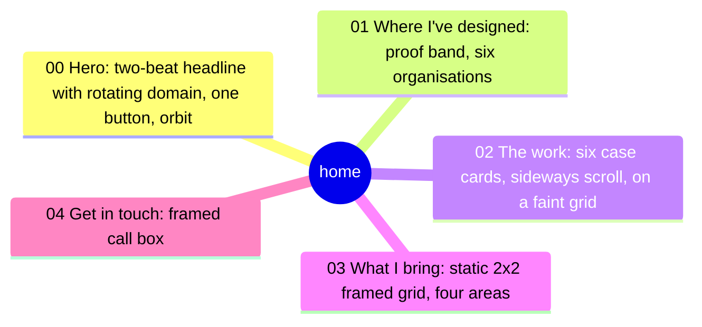
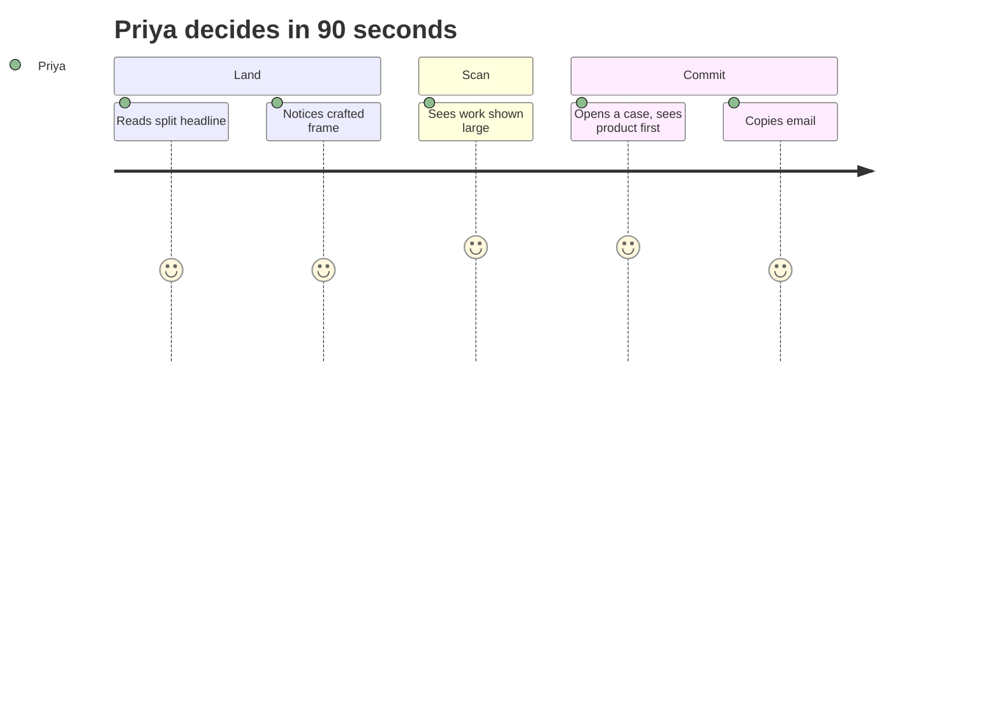

# EXPERIENCE.md

## Foundation
- Form factor: web, desktop-first for hiring managers, fully responsive.
- Stack: Next.js App Router, CSS modules, tokens from tokens/tokens.json. No Tailwind.
- Visual identity lives in DESIGN.md and is referenced as `{path.to.token}`.
- **Spines win on conflict.** Any mock, Stitch output or Taste Skill suggestion loses to these two files.

## Information Architecture
**v4 home (2026-10-10)**, after the claude.com product overview page:
1. Hero: centred serif headline (line two in accent), Ali's own one-sentence intro, Read the case studies and Resume, then the IIT Roorkee line under the buttons. Around it, two rings of work tiles, as on the claude.com product overview: 12 tiles on an inner ring turning clockwise (about 6 degrees a second) and 16 on an outer ring turning the other way (about 7.3 degrees a second); tiles stay upright. On load the tiles spiral out from a quarter of the radius at 20% scale into their places (cubic ease-out, about 1.1s). The inner radius is 0.6 of the hero height, or larger when needed to keep 48px between the words and the nearest tile. The outer radius is 0.825 of the height, or larger when needed so inner and outer tiles, captions included, never touch as they pass. Phones show the inner ring only, as an ellipse along the screen edges. Hovering a tile pauses both rings and opens a card for its case; there is one card for the whole hero, drawn above the headline layer and outside the rings' fade. The field is aria-hidden and not focusable; every case is reachable from #work.
2. Trailer: the enrollment trailer rises out of the hero on a tinted panel as you scroll. (The three numbered results under it were removed on 2026-10-11; the case cards right after repeat them.)
3. #work, Case studies: heading whose words light up on scroll, a row of tabs, then a pinned deck. The front card holds, then flies off to the right with a tilt while the next rises from the stack; the rail and the text on the left follow; each card carries its case's opening line as a printed caption at the top ("Where it started"), which fades up when the card comes to the front; on narrow screens the caption sits above the screen instead of over it. No chat or prompt styling: this is a portfolio, not an AI product. Tabs jump to a case and never leave the screen while you are in the section: on wide screens they sit at the top of the pinned stage, and in the list (under 960px or with reduced motion) they stick under the header, with the current tab scrolled into view on phones. Under 960px or with reduced motion it is a plain list.
4. Strengths: the capability map. Six branches growing out of "11 years in UX" as soft curves, lines drawing outward on scroll, leaves after. Leaves sit in one aligned column per branch. Otherwise the map is still: hovering a branch lights it in the accent and its curve eases out a little (0.5s), easing back on leave. Reduced motion keeps only the colour change. Phones get a list; screen readers always get the list.
5. Questions: native details/summary accordion.
6. #contact, then the footer.

The v3 order below is kept for history.

Home follows Deploy's order, with the work moved up; the reframe and "What changed" sections are gone:

/resume and /colophon keep their structure and pick up the tokens. URLs and slugs do not change.

Case study pages are moving, one study at a time, from the five beats (Frame, Stakes, Decisions, Outcome, Ownership) to a story layout: hero and summary unchanged, then numbered chapters with a plain first-person heading, paragraphs, and the study's diagrams and screens placed between the paragraphs where the story needs them. The side rail lists the chapters. A study opts in with `story` in its content; studies without it keep the beats. All six studies are converted (2026-10-10).

**Case pages on the v4 look (2026-10-11).** The summary box under the hero is gone (it repeated the hero and the first chapter). Story headings, hook lines and big numbers use the display serif; diagram and screen UI stays in the sans. Each case carries its home card tint as `--case-tint` on the article, and every product screen, video and screenshot sits on that tint. Hero tabs use the home tab style. The small label above each title is the case's home domain. Chapters alternate canvas and band, edge to edge. "Next case" is the home deck card (tint, real screen, "Where it started" line). Case 05's hero has no picture: the product image right under it is the visual. The "Live now" panel appears once, without crosshair corners. On narrow screens the next-case caption sits above its screen.

## Voice and Tone
Home: short and confident. Headlines in two beats: the claim, then the turn.
Everywhere: Ali's own voice, first person, the way he'd explain it to a colleague. Medium-length sentences joined with "and", "but", "so"; contractions; plain words. No arrows or dash ranges in prose ("from 9 steps to 5", not "9 → 5"), no buzzwords, no clipped slogan lines, no "not X, it's Y" formula. Copy is checked against the human-story-writer skill. No em dashes. No client names.

## Component Patterns
| Component | Behaviour |
|---|---|
| Split headline | Line two reveals after line one on first view; static under reduced motion. |
| Case cards | Sideways scroll with snap; arrow buttons step one card; the whole card is the link. |
| Orbit | Decorative and aria-hidden; spins at 60s per turn, still under reduced motion. |
| Capability grid (What I bring) | Four areas (Domain, Systems, People, AI) in one framed 2x2 grid with hairlines and crosshair corners, like the proof list. Each cell: index and tag, a small frameless line glyph, title, accent one-liner, points, and case-study chips pinned to the foot of the cell so a row lines up. All four visible at once: no pinning, no scroll-driven motion. One column under 860px. |
| Rotating word | Changes every 4s with a fade and small rise (old out, then new in); fixed width; the full sentence is in the h1 for screen readers; static under reduced motion. |
| Compare table | A real table: brief said vs what I found; row headers link to each case. |
| Eyebrow index | Section numbers match order on the page; not interactive. |
| Nav | Floating pill; Work, Contact, Resume; theme toggle kept. |

## State Patterns
Static site, so states are limited: image loading (reserve panel aspect ratio, no layout shift), video autoplay off under reduced motion, theme toggle remembers choice.

## Interaction Primitives
Motion budget: medium. Reveal on scroll for sections, line-two headline reveal, panel parallax at most subtle. Everything respects `prefers-reduced-motion`. Uses existing `motion.enter` and `motion.hover` tokens.

## Accessibility Floor
- Frame lines, crosshairs and ruler are `aria-hidden`.
- Accent on dark must pass 4.5:1 for text; check:contrast runs on every token change.
- Focus ring visible on dark; keyboard order follows visual order.

## Key Flows
[ASSUMPTION] Draft protagonist. Replace with a real one.
1. Priya, Head of Design at a US health-tech company, opens the link from a LinkedIn message between two calls.
2. Hero: in three seconds she reads the split headline and sees a framed, crafted page.
3. She scrolls to 01 Selected work and sees enrollment screens shown large, not thumbnails.
4. **Climax:** she opens one case and the first thing on screen is the designed product, with the reframe as a tight compare table beside it. Designer and business thinker, both visible in one view.
5. She clicks Resume or copies the email.

